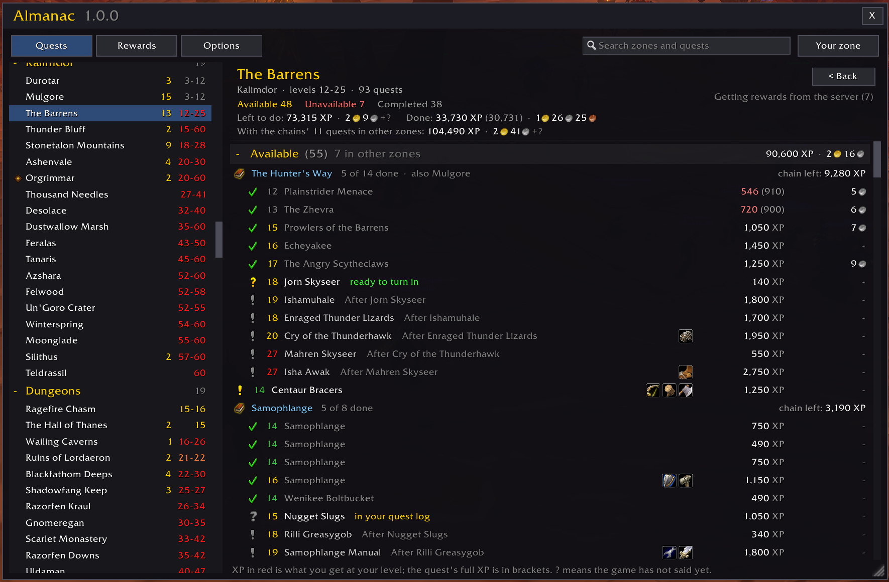
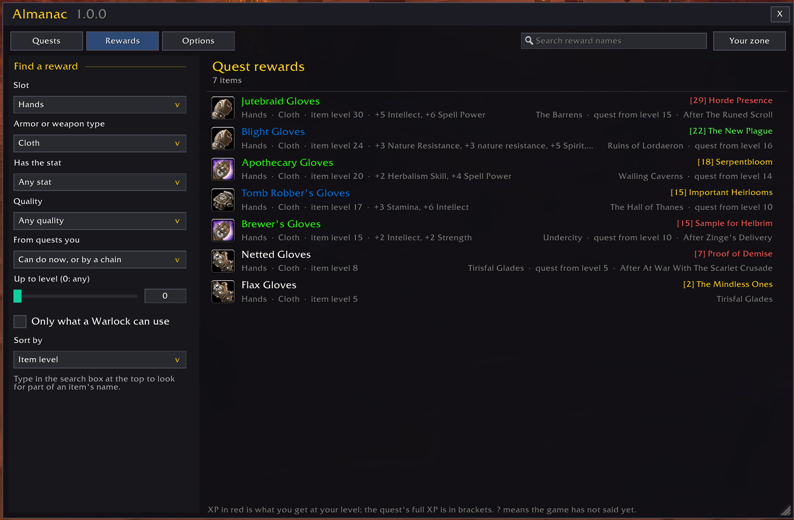

# Almanac

A quest almanac for WoW: Forever. Pick a zone, dungeon or raid and see every
quest there that your character can do, sorted into what you can take now,
what is not available yet (and why), and what you have done. Quest chains are
kept together, every quest, chain, zone and dungeon shows its XP and gold, and
you can search quest rewards for gear: a cloth chest with Intellect, say, and
the quests that give one.





## Features

- **Every zone, dungeon and raid.** The zones of the Eastern Kingdoms and
  Kalimdor in level order, then dungeons, raids, battlegrounds, your class's
  quests, profession quests and world events. Each shows its level range and
  how many quests you can take now. Starting areas such as Northshire Valley
  are part of their zone, and a dungeon lists every quest for it, wherever
  the quest giver stands.
- **Available, Unavailable, Completed.** Every quest is in one of the three:
  - **Available:** you can take it now, or it is in your quest log (marked
    when it is ready to turn in), or all it waits for is the quests before it
    in its chain.
  - **Unavailable:** not yet, and why: too low a level, reputation, a
    profession, a world event out of season. Quests you can no longer take
    (you chose the other quest of a pair, went past a breadcrumb, or are too
    high a level for it) come last.
  - **Completed:** turned in.
- **Chains.** Quests that follow one another are listed together under the
  chain's name, in the order they are done, with how far along you are and
  what is left of the whole chain. A chain you have started, or can start, is
  listed whole under Available: the quests you have done, the one you can
  take, and those after it, including its quests in other zones (greyed,
  with their zone). Only a quest that needs more than the ones before it,
  such as a higher level, goes under Unavailable. So a dungeon's page shows
  the quests to do before it: the Westfall quests that lead to The Defias
  Brotherhood in the Deadmines, for example. Click the chain's name to see
  all of it, from its first quest to its last.
- **XP and gold everywhere.** Each quest shows its XP and money; each chain,
  section, zone and dungeon its totals, for what is left to do and for what
  you have done. A section's totals count the chain quests it lists from
  other zones too, and a page's header adds them up with the zone's own.
- **XP for your level.** A quest gives less XP once you are more than five
  levels above it: 80% at six levels, down to 10% at ten or more, and none at
  the highest level. Almanac shows what you would get, with the quest's full
  XP beside it.
- **What quests really give.** WoW: Forever gives more XP than the quest
  database lists for many dungeon quests. When one of your characters turns a
  quest in, Almanac remembers what it gave, and estimates the other quests of
  that dungeon from it (marked ~).
- **Forever's new dungeons.** Until QuestieDB has them, Almanac lists the
  quests of WoW: Forever's new dungeons (The Hall of Thanes, Ruins of
  Lordaeron), its new Deadmines quest, and the quests that lead to them or
  follow them, such as Toxic Soil in Westfall: 32 quests, with the XP they
  give on Forever. The game supplies their money and rewards. Each drops out
  by itself once QuestieDB adds it. If Forever Dungeon Journal is installed,
  Almanac also lists any new dungeon quest it knows that Almanac's list lacks.
- **Reward search.** Search every quest reward by slot, armor or weapon type,
  stat, quality and level, and see which quest gives each item, from what
  level, and whether you can do it. It lists the rewards of the quests you
  can do now, including the end of a chain you can do now, or of every quest
  you can still do one day. Levels count both the item's and its quest's. It
  only lists what your class can use, counting mail and plate from level 40
  for the classes that learn them then.
- **Your faction and class.** Quests for the other faction, other races and
  other classes are left out (the options can show them).
- **Quest search.** Type part of a quest's name to find it in any zone.
- **EllesmereUI's look,** when EllesmereUI is installed.

## Supported game versions

| Game | Folder | Interface |
|---|---|---|
| WoW: Forever | `_classic_beta_` (beta) | 16001 |

## Requirements

Almanac reads its quests from **QuestieDB**, the quest database that comes
with [Questie](https://www.curseforge.com/wow/addons/questie). Install Questie
and keep its QuestieDB addon turned on. When Questie itself is on, Almanac
also leaves out the quests Questie hides: quests that are not in the game,
duplicates, and world event quests out of season.

The new dungeon quests Forever added that QuestieDB does not have yet, and the
quests around them, come with Almanac (`ForeverQuests.lua`). Its facts were
checked against
[Wowhead's Forever database](https://www.wowhead.com/forever),
[wowforevertalents.com](https://wowforevertalents.com/quests/) (read from the
beta client), and [foreverchanges.pro](https://foreverchanges.pro/) and
quissy.tv for the XP the beta gives. **Forever Dungeon Journal** (by
Exehn) is not needed; when it is turned on, Almanac also reads any new dungeon
quest the journal knows that its own list lacks.

## Installing

1. Install Questie (see above).
2. Copy the `Almanac` folder into the game's AddOns folder, for example
   `World of Warcraft\_classic_beta_\Interface\AddOns\Almanac`, and restart the
   game (a new addon is only found at start-up, not by `/reload`).

## Using it

Open it with the button on the minimap, `/almanac`, a key binding, or the
addon compartment by the minimap. It opens on the zone or dungeon you are in,
or, if you have not moved on since, where you left it. The minimap button can
be dragged around the minimap, and turned off in the options.

### Quests

- **Left:** the zones, by group. Click a group's name to fold it up. The gold
  number is how many quests you can take there now; the range on the right is
  the level of most of its quests, colored for your level.
- **Top of the page:** the zone's levels, how many of its quests are in each
  section, and the XP and money left to earn there and already earned. When
  its chains go on into other zones, a last line gives what is left counting
  those quests too.
- **Sections:** each counts and totals what it lists, including a chain's
  quests from other zones ("2 in other zones").
- **Each quest:** its status icon, level (colored for your level), name, why
  it is not available yet, its reward items, its XP and its money. XP in red
  is what you would get at your level, with the full XP in brackets. A `?`
  means the game has not said yet (money is only known once the game lists
  it; Almanac asks for the quests on screen), and `-` that the quest gives no
  money. A `~` means an estimate.
- **A chain's quests in other zones** are greyed and say which zone they are
  in; more than six in a row from one zone are one line, which shows the
  whole chain when clicked.
- **Hover** a quest for everything about it: who starts and ends it and
  where, what it needs, where it is in its chain, XP, money, reputation and
  rewards. Hover a reward icon for the item.
- **Click** a quest in a chain to see the whole chain; on a chain's page or in
  search results, click a quest to go to its zone.
- **Shift-click** a quest or a reward icon, with the chat box open (Enter), to
  put it in what you are typing. A quest in your quest log goes as the game's
  quest link; the game links no others, so any other goes as its name and ID,
  "[Westfall Stew (36)]", which Questie turns into a link for players who
  have it.
- **Your zone** goes back to where you are. **Back** returns from a chain or
  a search.

### Rewards

The **Rewards** page lists quest reward items, filtered on the left by slot,
armor or weapon type, stat, quality, the quests they come from, and level, and
sorted by item level, the level you can have them at, name, or how much of the
chosen stat an item has.

- **From quests you:** *can do now, or by a chain* (the default) lists the
  rewards of the quests you can take now or have taken, and of the quests
  that only wait for the quests before them in a chain you can do now; *can
  still do* those of every quest you have not done and can still take; *any
  quest* everything.
- **Up to level:** leaves out items that need a higher level, and items whose
  quest needs a higher level. An item can be had at the level it needs, or
  the level its quest needs if that is higher; each result says which quest
  gives it and from what level.
- **Only what your class can use:** judged at the level you can have the item.

Type in the search box for part of an item's name. Click an item to go to its
quest; shift-click it, with the chat box open, to link it.

## Commands and keys

| Command | Does |
|---|---|
| `/almanac` | Open or close the window |
| `/almanac defias` | Find quests by name |
| `/almanac rewards` | Open the Rewards page |
| `/almanac rewards robe` | Find quest rewards by name |
| `/almanac options` | Open the options |
| `/almanac minimap` | Show or hide the minimap button |
| `/almanac probe 166` | Show what Almanac knows about a quest: the database, what the game lists, and what it has learned (for reporting problems) |

Keys can be set in the game's key bindings, under **Almanac**. On the minimap
button and in the addon compartment by the minimap, left-click opens the
window and right-click the options.

## Options

- **Which quests are listed:** the other faction's quests, other races' and
  other classes' quests, quests you can no longer take, and quests Questie
  hides.
- **Totals, tooltips and buttons:** counting repeatable quests in the totals,
  opening the Completed section, quest IDs in tooltips, the minimap button,
  and the window's scale.
- **What quests give:** forgetting the XP, money and rewards Almanac has seen
  quests give (it learns them again as you play).

## Development

```
Almanac/
  Almanac.toc       Interface number, QuestieDB dependency and load order
  Bindings.xml      Key bindings
  Locales.lua       Strings (English; other languages can be added here)
  Compat.lua        Game version, API wrappers, events
  Database.lua      Saved data and settings
  Data.lua          Reading QuestieDB: quests, zones, dungeons, items
  ForeverQuests.lua Forever's new quests that QuestieDB lacks (data)
  NewQuests.lua     Listing those, and any more from Forever Dungeon Journal
  Player.lua        The character: level, race, class, quests done and taken
  Status.lua        Whether a quest can be taken, and why not
  Rewards.lua       XP, money and reward items, from the game and turn-ins
  Catalog.lua       The quest list by zone, and quest chains
  Items.lua         Quest reward items, and the reward search
  Widgets.lua       Flat controls, shared with Knapsack and Missing Buffs
  Skin.lua          EllesmereUI's skin, when it is installed
  Tooltip.lua       Quest, chain and item tooltips
  QuestList.lua     The zone, chain and search pages
  RewardSearch.lua  The Rewards page
  Options.lua       The Options page
  Window.lua        The window and the zone list
  Minimap.lua       The minimap button
  Core.lua          Startup and /almanac
tests/              Tests run against a mock of the WoW API
```

Run the tests with Lua 5.1 from the repository root:

```
lua5.1 tests/run_tests.lua
```

The tests use a small made-up quest database. If QuestieDB is installed, they
also load it and run Almanac against the real quests (and say which of
Almanac's new Forever quests QuestieDB has now), and with Forever Dungeon
Journal too if it is installed (saying what it adds); set
`ALMANAC_WOW_ADDONS` to the AddOns folder if it is not in the usual place.

When Forever adds or changes quests QuestieDB does not have yet, update
`ForeverQuests.lua`; once QuestieDB has them all, the file can be emptied.

While developing, you can link the `Almanac` folder into the game's AddOns
folder (a directory junction or symbolic link) instead of copying it, so
changes show up after a `/reload`.

When a patch changes the interface number, change the `## Interface:` line in
`Almanac.toc`.
